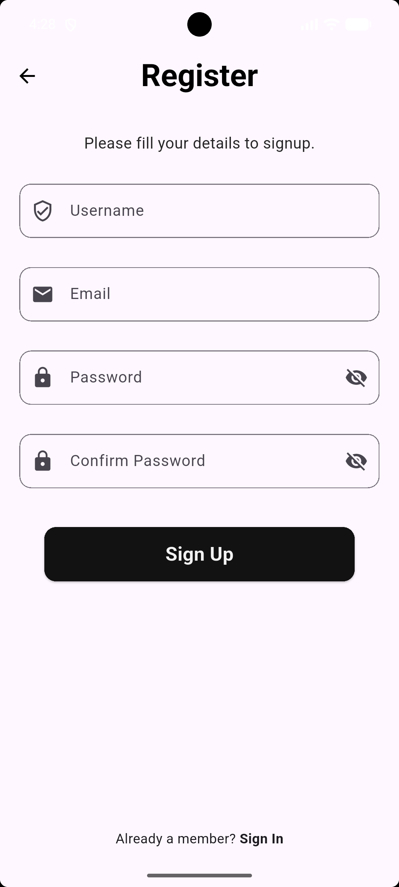
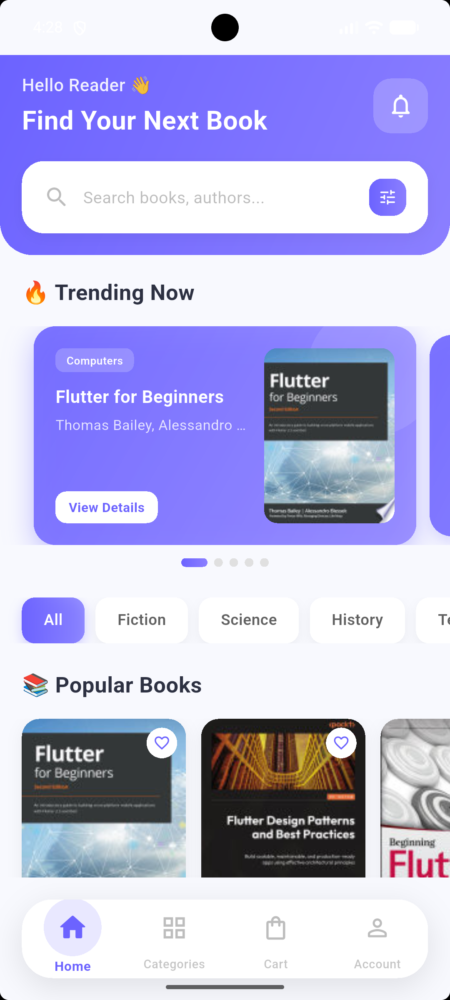
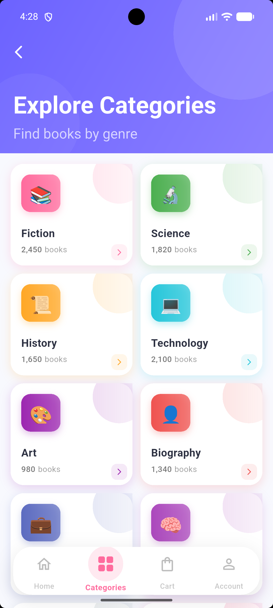
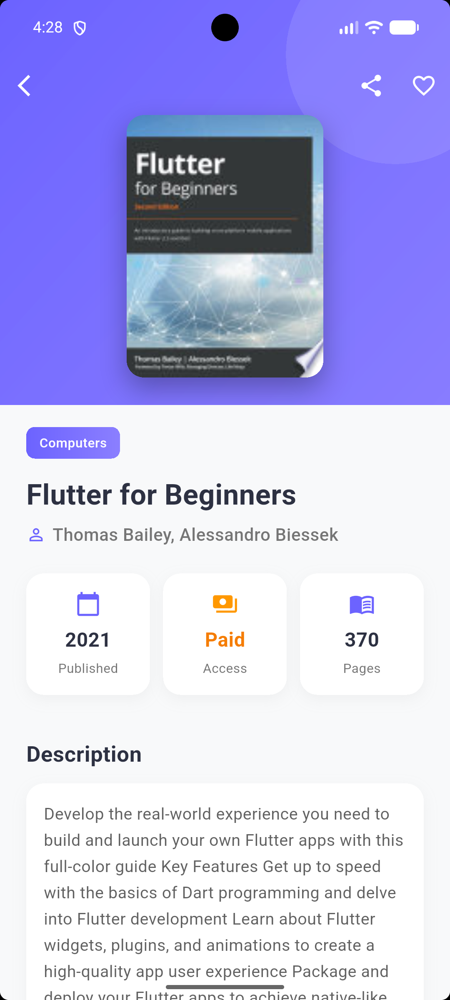
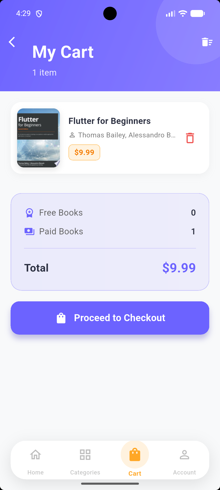
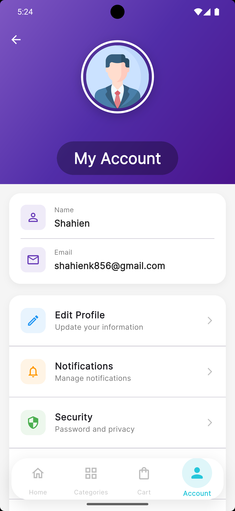

# Book App

Book App is a Flutter book-discovery application built around the Google Books
API. It supports category browsing, book search, account flows, book details,
and an in-memory cart experience.

> Portfolio project. Checkout is a prototype and the application is not
> published to a public app store.

## Product experience

- Welcome, registration, and login screens
- Google Books discovery and category browsing
- Search and reusable book cards
- Book details with resilient thumbnail and metadata handling
- In-memory cart add, remove, and clear actions
- Account and bottom-navigation screens

## Interface

<p align="center">
  
  
  
  
</p>

<p align="center">
  
  
  
  
</p>

## Technical overview

- **Framework:** Flutter and Dart
- **State and navigation:** GetX controllers, bindings, and routes
- **Networking:** Dio with timeout and connection error handling
- **Content:** Google Books API
- **Accounts:** Firebase Authentication and Cloud Firestore
- **UI:** Material components, Google Fonts, reusable book widgets

The project follows a practical feature-first organization. It separates views,
controllers, routes, Firebase setup, API access, models, and shared widgets, but
does not claim a full Clean Architecture implementation.

```text
lib/
├── core/
│   ├── api/
│   ├── controllers/
│   ├── firebase/
│   ├── models/
│   ├── routes/
│   ├── theme/
│   └── widgets/
├── features/
│   ├── account/
│   ├── cart/
│   ├── category/
│   ├── details/
│   ├── home/
│   ├── login/
│   ├── register/
│   ├── splash/
│   └── welcome/
└── main.dart
```

## Getting started

### Requirements

- Flutter matching the SDK constraint in `pubspec.yaml`
- A Firebase project for the account features
- Network access to the public Google Books API

```bash
git clone https://github.com/Khaled-shahien/Book_App.git
cd Book_App
flutter pub get
flutter run
```

To use a separate Firebase project:

```bash
flutterfire configure
```

Firebase client configuration should be restricted to the intended applications
and APIs. Never commit service-account keys, signing credentials, or other server
secrets.

## Configuration, testing and release

### Environments (dev / staging / prod)
Config is injected at compile time with `--dart-define-from-file`. Copy a template once (the copies are git-ignored):

```bash
cp env/dev.example.json env/dev.json
flutter run --dart-define-from-file=env/dev.json
```

Keys: `APP_ENV`, `BOOKS_API_BASE_URL`, `BOOKS_API_KEY` (optional). See `lib/core/config/app_config.dart`.

### Firebase
Firebase configuration files are intentionally ignored and must not be committed. Generate them locally with the FlutterFire CLI:

```bash
dart pub global activate flutterfire_cli
flutterfire configure
```

Security rules live in `firestore.rules`; deploy with `firebase deploy --only firestore:rules`.

### Testing

```bash
dart format --output=none --set-exit-if-changed lib test
flutter analyze --fatal-infos
flutter test --coverage
```

Unit tests cover the API client (with a scripted HTTP adapter), models, validators, cart money math and `BookController`. Widget tests cover splash routing, Home loading/error/empty/success, and the form widgets.

### Release

```bash
# Android: requires android/key.properties (see android/key.properties.example)
flutter build appbundle --release --obfuscate --split-debug-info=build/symbols \
  --dart-define-from-file=env/prod.json

# iOS
flutter build ipa --release --obfuscate --split-debug-info=build/symbols \
  --dart-define-from-file=env/prod.json
```

Keep `build/symbols` to symbolicate crash reports. The remaining manual release steps are in [docs/HUMAN_ACTIONS.md](docs/HUMAN_ACTIONS.md); the audit and decisions are in [docs/](docs/).

## Current limitations

- Cart state is in memory and is not restored after the app restarts
- Checkout displays a planned-feature message and does not process payments
- Firebase emulator and end-to-end tests are not configured
- Localization/RTL and dark mode are not yet supported (see docs/PROGRESS.md)

## Maintainer

Built and maintained by [Khaled Shahien](https://github.com/Khaled-shahien).
Professional contact details are available on the
[GitHub profile](https://github.com/Khaled-shahien).
