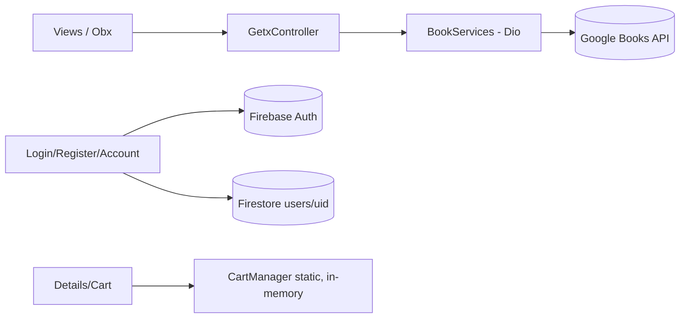

# Audit Report — Book App

Branch audited: `chore/repository-optimization` @ `bb1468d` (2026-11-04).
Fixes land on the `production-readiness` branch.

## Baseline tool results

| Check | Result |
|---|---|
| `flutter pub get` | OK (21 packages have newer, incompatible versions) |
| `flutter analyze` | 5 issues (2 warnings, 3 infos) |
| `flutter test` | 1 test, passing (smoke test only) |
| `flutter pub outdated` | `cloud_firestore` 6.9→7.1, `firebase_auth` 6.6→7.0, `firebase_core` 4.14→5.1, `google_fonts` 6.3→9.0, `cupertino_icons` 1→2 (all major bumps) |
| Toolchain | Flutter 3.48.0-0.5.pre (**beta** channel), Dart ^3.10 |

## 1.1 Project map

- **Stack:** Flutter + Material 3. State and DI with GetX (`GetxController`, `Obx`, `Bindings`). Networking with Dio (Google Books API). Firebase Auth (email/password) and Cloud Firestore (`users/{uid}` profile). No local persistence and no code generation. Navigation uses GetX named routes plus some `Get.to`/`Navigator.push` with widget instances.
- **Features:**
  - `splash`: timed splash, then routing.
  - `welcome`: entry point to login and register.
  - `login` / `register`: GetX controllers that call Firebase Auth; register also writes the Firestore profile.
  - `home`: `BookController` over `BookServices` (Google Books). Shows a carousel, category chips, and horizontal and grid sections.
  - `category`: a static category grid, then a books grid for the chosen category.
  - `details`: book info, plus add to / remove from cart.
  - `cart`: an in-memory static `CartManager` with a flat demo price.
  - `account`: reads the Firestore profile directly from the widget; logout.
- **Navigation map:** `/` splash → `/welcome` → `/login` | `/register` → `/home`. `/home` is a shell (IndexedStack: Home, Categories, Cart, Account). Category books and details are pushed as unnamed routes. There are no deep links. `Routes.details` and `Routes.search` were declared but unused.
- **Data flow:**

- **Dependency inventory:**

| Package | Used | Notes |
|---|---|---|
| get 4.7.x | yes | maintained; kept (D-001) |
| dio 5.9 | yes | |
| firebase_core / auth / cloud_firestore | yes | major updates available (deferred, D-006) |
| google_fonts 6.3 | yes (Inter) | fetches fonts at runtime (privacy/offline), D-007 |
| cupertino_icons | no usage found | harmless; kept |
| flutter_lints 6 | dev | |

## 1.2 Bugs and correctness (verified by reading code and, where possible, by tests)

| Finding | Status |
|---|---|
| Category screen reused Home's shared controller, so opening a category replaced Home's books | fixed |
| Stale out-of-order search responses overwrote newer ones | fixed + test |
| Network errors were shown as "No books found" with no retry; raw `e.toString()` reached users | fixed + tests |
| Splash always went to Welcome; signed-in users had to log in again on every launch | fixed + test |
| Passwords were `.trim()`-ed before sign-in/sign-up | fixed |
| Modern `invalid-credential` and other auth codes were unmapped ("Login failed") | fixed + tests |
| Register showed `Something went wrong: $e`; a Firestore failure after the account existed stranded the user | fixed |
| Details "Undo" called `setState` after the page could be disposed (crash) | fixed |
| Clear-cart used the dialog's context after popping it | fixed |
| Money computed with `double` (`fold<double>` + 9.99) | fixed → integer cents + tests |
| Logout did not clear the static cart, so it leaked to the next user | fixed |
| Account page: `setState` without a `mounted` check; `print`; hotlinked third-party avatar | fixed |
| Forgot password not implemented | implemented |
| Firebase init failure crashed before `runApp`; no global error handlers | fixed |
| Hero tag used the title (not unique) | fixed |
| Dark mode: hardcoded light surfaces + system theme gave unreadable text | mitigated (light-only, D-005) |
| (suspected) `!` on `formKey.currentState` | replaced with a null-safe check |
| Layout at 200% text scale / landscape not verified on device | open (⚠️) |

## 1.3 Security (OWASP MASVS)

| MASVS | Finding | Status |
|---|---|---|
| STORAGE | No secrets committed (`google-services.json` is local only and ignored). Firebase manages tokens; the app stores no tokens of its own, so secure storage is not needed. | OK |
| STORAGE | `allowBackup` defaulted to true, exporting auth state | fixed |
| NETWORK | Cleartext not explicitly disabled; Google Books thumbnails are `http://` | fixed (HTTPS upgrade + NSC) |
| NETWORK | Logging of queries in release (`dart:developer log`) | fixed (debug-only) |
| AUTH | Error messages allowed account enumeration | fixed |
| PLATFORM | No Firestore rules in repo; backend state unknown | rules written, deployment is a human action |
| RESILIENCE | Release signed with the debug key, no R8 | fixed (key.properties + R8) |
| RESILIENCE | No App Check | ❌ human action |
| CODE | Dependencies have major updates; no known CVEs found | deferred |

## 1.4 Performance

- `Image.network` decoded full-size covers → `cacheWidth` added everywhere.
- ~10 MB of assets bundled but unused (12 images + README screenshots + font) → removed.
- Chip taps replaced the whole page with a spinner → inline progress.
- Lists are lazy (`ListView.builder` / `SliverGrid`); the cart list uses `shrinkWrap` (small lists, acceptable).
- No pagination (30 results per query). The cache was unbounded → bounded LRU.

## 1.5 UI/UX

- Colors and sizes are hardcoded per screen; the theme is only partially used.
- Loading/empty states existed. Error states with retry were missing → added for Home and Category.
- No localization; the target market is not stated. ARB/RTL is not implemented (⚠️).
- Forms lacked autofill and keyboard actions → added. Password toggle now has a tooltip.
- No-op controls (Share, settings tiles) → Share removed, tiles show "Coming soon".

## 1.6 Architecture

Feature folders exist, but the layering is inconsistent: the Account page talks to Firestore directly, and controllers used `FirebaseAuth.instance` in field initializers. Target: GetX controller → service/repository with constructor injection (D-002). Applied to books, auth and session. The Account page still needs its own controller (⚠️).

## 1.7 Repository hygiene

Stray AI prompt file, unused widgets and nav-bar variants, an empty file, and `pubspec.lock` ignored while still tracked → all fixed. The CI ran tests with `continue-on-error` and shipped debug-signed APKs on release → rewritten.

## 1.8 Prioritized issues

| ID | Area | Severity | File(s) | Problem | Impact | Fix | Effort | Status |
|---|---|---|---|---|---|---|---|---|
| A1 | Correctness | High | category_books_view.dart | shared controller | Home content replaced | per-page controller | S | ✅ |
| A2 | Correctness | High | splash_controller.dart | ignores session | forced re-login | route by auth | S | ✅ |
| A3 | Security | High | build.gradle.kts | debug-signed release, no R8 | unshippable | key.properties, R8 | S | ✅ |
| A4 | Security | High | (backend) | no rules in repo | possible open DB | firestore.rules | S | ✅ written / ❌ deploy |
| A5 | Correctness | High | login/register | trimmed passwords, unmapped errors | wrong logins | fix + mapper | S | ✅ |
| A6 | Correctness | High | book_details_page.dart | setState after dispose | crash | listener + mounted | S | ✅ |
| A7 | Privacy | High | session | cart leaks across accounts | data exposure | clear on logout | S | ✅ |
| A8 | Compliance | High | account | no account deletion | store rejection | implemented | M | ✅ |
| A9 | Correctness | Medium | book_controller | stale responses | wrong results | request sequencing | S | ✅ |
| A10 | Money | Medium | cart_page | double arithmetic | rounding | int cents | S | ✅ |
| A11 | UX | Medium | home/category | no error/retry | dead end | ErrorStateView | S | ✅ |
| A12 | Network | Medium | manifest | cleartext/backup | token export | NSC, backup off | S | ✅ |
| A13 | Perf | Medium | assets | ~10 MB unused | app size | removed | S | ✅ |
| A14 | UX | Medium | theme | dark mode unreadable | broken UI | light-only now | S/L | ⚠️ |
| A15 | i18n | Medium | all | hardcoded English | market fit | ARB + RTL | L | ❌ |
| A16 | Observability | Medium | main | no crash reporting | blind in prod | hook ready; Crashlytics | M | ⚠️ |
| A17 | Deps | Low | pubspec | major Firebase bumps | drift | stepwise upgrade | M | ❌ |
| A18 | Arch | Low | account_page | UI calls Firestore | testability | AccountController | M | ❌ |
| A19 | Release | Low | gradle/ios | `com.example.*` IDs | store rejection | human decision | S | ❌ human |

## Phased plan

1. Cleanup → 2. Core networking/error model → 3. Correctness fixes (home, cart, auth) → 4. Platform hardening + rules → 5. CI + stricter lints → 6. Tests → 7. Docs and human actions. Larger UI work (tokenized theme, dark mode, l10n/RTL, golden and integration tests) is planned as follow-up (see FINAL_REPORT).
